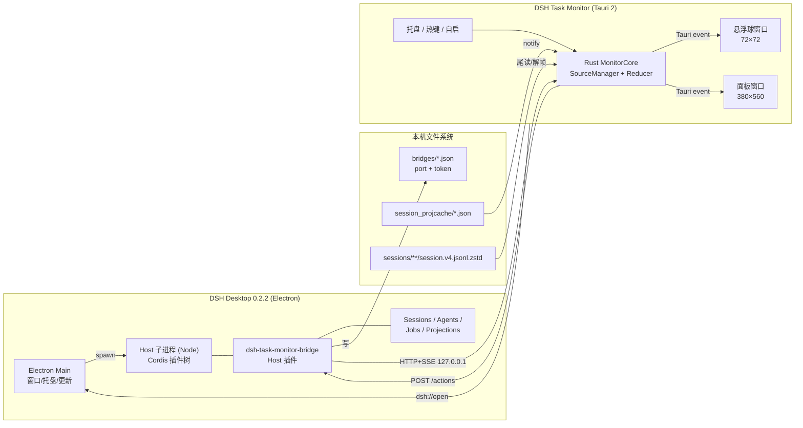
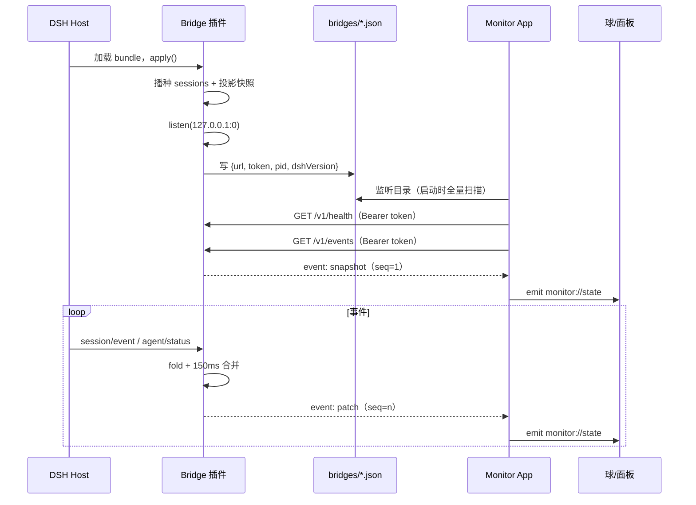

# DSH 任务监控悬浮窗（DSH Task Monitor）解决方案

> 版本：v1.0 · 日期：2026-11-09 · 目标环境：Windows 10/11 x64，DeepSeek Harness Desktop `0.2.2-rc.1`
> 参考项目：`<teleagent-monitor>`（Tauri 2 + Vue 3 任务悬浮窗）

---

## 0. 结论先行

| 决策项 | 结论 |
|---|---|
| 产品形态 | **独立 Windows 悬浮窗应用**（Tauri 2）：缩略悬浮球 + 任务面板 + 托盘，置顶、透明、吸附、多屏 |
| 与 DSH 的接入方式 | **DSH Host 插件做「数据桥」**，悬浮端通过本机回环 HTTP + SSE 订阅；插件是首选高质量通道 |
| 是否必须装插件 | **不必须**。内置「只读文件适配器」作为兜底：直接读 DSH 的投影缓存与会话日志，零安装即可用 |
| 纯插件能否实现 | **不能**。Client 插件只能渲染在 DSH 页面内，无法创建系统级置顶悬浮窗；Host 插件进程也没有 Electron 窗口能力 |
| 是否修改 DSH 本体 | **不建议**。不 patch `app.asar`、不改 Electron 主进程；随 DSH 升级会被覆盖且风险高 |
| 实时性 | 插件模式：事件驱动，典型 **< 300 ms**；文件模式：投影缓存最多 **5 s** 滞后，日志尾读可做到亚秒级状态 |
| 交付物 | ① 一个 DSH bundle 包（Host 插件，可选内置 Client 小组件）；② 一个 Windows 安装包（Tauri，含 MSI/NSIS） |
| 实施周期 | 单人约 **4–6 周**（M0 技术验证 3–4 天，M1 MVP 2 周，M2 完整度 2 周） |

一句话：**用插件解决「接得准」，用原生应用解决「浮得起来」，用文件兜底解决「装不上也能用」。**

> **实现进展（2026-11-09，M1）**：Tauri 双窗口、托盘/吸附、Rust 单状态源、文件适配器、Host 插件桥（发现文件 + token + `/v1/snapshot` + SSE + 动作）均已落地并通过真机验证；当前 Rust 端以 **500 ms 快照轮询** 接入插件（延迟 p95 约 0.5 s），SSE 直连解析列为 M2。热键默认改为 `Ctrl+Alt+Shift+M`（`Ctrl+Alt+M` 在本机已被占用）。
>
> **同日修复**：`待介入` 统计徽标误用了悬浮球的 `.is-waiting` 脉冲动画，导致 0 待介入时持续闪烁，已把动画作用域收窄到 `.ball.is-waiting`；面板新增 `◎` 切回悬浮球、`✕` 隐藏到托盘，球点击打开面板，形成双向切换。

如果只能选一个方向：**选独立应用**（保证任何 DSH 状态下都能用）；要完整体验：**独立应用 + 插件**。不选「纯插件」，也不选「纯文件」。

---

## 1. 需求与边界

### 1.1 需求拆解

| 优先级 | 需求 | 说明 |
|---|---|---|
| P0 | 实时任务进度面板 | 展示 DSH 每个会话（任务）的标题、工作目录、阶段、当前步骤、Todo 进度、耗时 |
| P0 | 缩略悬浮球 | 常驻桌面、置顶、可拖动、边缘吸附、颜色/数字表达全局状态 |
| P0 | 托盘常驻 | 左键显隐、右键菜单、退出；关闭面板不退出 |
| P0 | 状态可辨识 | 运行中 / 需介入（审批、提问）/ 完成 / 失败 / 中断 / 离线 |
| P1 | 后台任务与子代理 | 展示 shell/job 运行数、子代理任务、工作流步骤 |
| P1 | 快速聚焦 DSH | 点击任务卡片唤起 DSH 主窗口（`dsh://open`） |
| P1 | 多实例/多 Profile | 同时监控桌面端、CLI、Web 多个 DSH 实例 |
| P2 | 面板内操作 | 停止当前回合、终止后台任务（需用户确认） |
| P2 | DSH 页面内小组件 | Client 插件在 `shell.overlay` 内提供同风格迷你球 |
| P2 | 通知 | 「需介入」时 Windows Toast / 声音提醒 |

### 1.2 术语

- **会话（Session）**：DSH 中一条事件溯源日志，通常对应一次用户任务；监控中一个会话 = 一张任务卡片。
- **回合（Turn）/ 步骤（Step）**：一次用户输入触发的完整执行（Turn），内部由若干模型/工具步骤（Step）组成。
- **Todo**：Agent 通过 `todo_write` 工具维护的任务清单，是进度最可靠的用户可见信号。
- **Job**：后台任务（`pwsh`、`bash`、子代理等），通过 `job/registered` / `job/settled` 事件记录生命周期。
- **Goal**：长目标（可跨回合），有 round 概念；与 Todo 不同，不是每个会话都有。

### 1.3 非目标

- 不在监控端执行/修改 DSH 的会话内容、不写入日志、不代替用户做审批。
- 不替代 DSH 自身的会话列表与对话界面；面板只做「只读投影 + 少量控制」。
- 不做跨机器远程监控（首版仅本机；远程可作为后续 Bridge over TLS 的扩展）。
- 不追求像素级复刻 DSH 主题；悬浮端保持独立视觉，但要与 DSH 状态语义一致。

---

## 2. 参考项目复盘（teleagent-monitor）

### 2.1 已有实现

- **技术栈**：Tauri 2（Rust）+ Vue 3.5 + TypeScript + Vite 6。
- **窗口**：两个无边框透明置顶窗口，`ball`（40×100 竖条加速球）与 `main`（380×500 面板），`skipTaskbar: true`、`focus: false`、`shadow: false`；按窗口 label 挂载不同 Vue 组件。
- **数据**：Tauri command 轮询 SQLite（`immutable=1` 只读）+ `notify` 监听 `session-status.json`，前端 3 s / 10 s 双定时器；四态由「最后消息 finish + 状态文件 + 超时」推导。
- **交互**：加速球上格刷新、下格红绿灯；`onMoved` + 300 ms 防抖做边缘吸附（物理像素、`workArea` 基准）；托盘与设置面板；配置外置 `config.json`。
- **经验值**：WebView2 透明窗口 `outerSize` 与内容尺寸不一致，需要 `setSize` 修正；吸附必须统一物理像素。

### 2.2 可复用与需改进

| 维度 | 参考项目 | 本项目改进 |
|---|---|---|
| 窗口/托盘/吸附 | 成熟 | 直接复用，补多屏与 DPI 变更处理 |
| 数据获取 | 每个窗口各自轮询，3 s 延迟 | **Rust 单连接 + 单状态源**，事件推送，窗口只渲染 |
| 数据来源 | 读第三方 DB + 状态文件 | **DSH 官方事件/投影**（插件）或**投影缓存+日志**（兜底） |
| 状态推导 | 时间戳超时启发式 | 用 `agent/status`、`turn/end.reason`、`userQuestions`、审批事件精确判定 |
| 可扩展性 | 单产品硬编码 | 多数据源（多 DSH 实例/Profile）、协议版本化 |
| 交互 | 球点击展开面板 | 增加悬停速览、需介入置顶、任务卡片聚焦 DSH |

> 结论：窗口层几乎可以照搬；**数据层要重做**，这是本项目与参考项目的本质差异。

---

## 3. DSH 现状调研（0.2.2-rc.1）

### 3.1 运行形态：Electron 壳 + 独立 Node Host 子进程

- 安装目录 `<DSH install>\`，Electron 主进程入口在 `resources/app.asar/lib/main.js`。
- 主进程通过 `spawn` 启动 **独立的 Host 进程**（`@deepseek-ai/dsh-desktop-host`，以 `ELECTRON_RUN_AS_NODE` 方式运行），Host 再加载 profile 的 Cordis 插件树。
- 渲染进程安全配置：`sandbox: true`、`contextIsolation: true`、`nodeIntegration: false`，且 `setWindowOpenHandler(() => ({ action: 'deny' }))`。**页面内插件无法创建系统窗口。**
- 桌面单实例：`requestSingleInstanceLock()`，二次启动聚焦主窗口；注册 `dsh://` 协议，当前仅处理 `dsh://open` 聚焦。
- 托盘、自动更新、欢迎页等均由 Electron 主进程实现，**没有开放给第三方插件的窗口扩展 API**。
- 本机同时存在 Web Server（`DSH_WEB_URL=http://127.0.0.1:6870`），根路径返回 **401**：浏览器访问需要启动 token 换取的签名 Cookie。

**含义**：Host 插件是 Node 代码，能拿到 DSH 内部服务与事件，但不能直接 `new BrowserWindow()`；系统悬浮窗必须由独立应用实现。

### 3.2 插件体系：Cordis bundle（Host + Client 两半）

- Profile：`%USERPROFILE%\.dsh\profiles\desktop`，`package.json` 的 `dsh.profile.bundles` 选择 bundle，`cordis.patch.yml` 是用户补丁层。
- 当前 bundle：`@deepseek-ai/dsh-base`、`@deepseek-ai/dsh-web-app`、`dsh-our-free-model`。
- **bundle** = 带 `dsh.bundle.patch` 的 npm 包，其 YAML 补丁 `insert` 插件行（`id`、`name`、`config`）。
- **Host 插件**：ESM `index.js` 导出 `apply(ctx, config)`（或 Service class），可声明 `inject` 与 schemastery `Config`；资源必须用 `ctx.effect` / `ctx.on` 注册并在卸载时释放。
- **Client 插件**：`package.json` 声明 `dsh.client`（`platform: 'web'`、`immediately`、`inject`、`external`），`./client` 产物用 `window.__ModuleLoader__.load({ id, factory(require) })` 注册；React 来自宿主模块表，插件只注册 slot 组件。
- 可用 UI 槽位包括 `conversation.composer.dock`、`shell.bottom`、`shell.leading`、**`shell.overlay`（覆盖整个框架的根级浮层）** 等。
- 安装：`dsh plugin --profile desktop add <spec>`（转发 pnpm），bundle 选择在 **Settings → Plugins** 或 `plugin_manager` 工具中完成；版本兼容由 `engines.dsh` / DSH peer 依赖检查。
- HMR：配置变更通常热生效；**包替换**（升级同一包）需要重启 Host 才能加载新的 JS 模块。

### 3.3 数据与事件：事件溯源 + 投影

- 会话日志：`%USERPROFILE%\.dsh\sessions\<workspace-slug>\<session-id>\session.v4.jsonl.zstd`。
  - 实测为**多帧 zstd 拼接**（一个样本 375 个事件、202 个 frame），`zlib.zstdDecompressSync` 只能解第一帧，需要按魔数 `28 b5 2f fd` 切帧逐帧解压。
  - 官方写入为「每批持久化事件一个带校验和的 frame」，**批次窗口 200 ms**（`dsh-session-persistence-jsonl` 内部调度，不可配置），因此日志尾读的状态延迟通常在 200–400 ms。
- 投影缓存：`%USERPROFILE%\.dsh\storages\session_projcache\sessions\<session-id>.json`，版本 `7`，`record.rows` 内含 `title`、`todos`、`sessionStats`、`turnBoundary`、`goal`、`plan`、`userQuestions`、`tokenUsage`、`contextPressure`、`modelSelection`、`workingDirectory`、`sessionListMetadata` 等。
  - 写入节流：`writeEveryEvents: 200`、`writeIntervalMs: 5000`，并在 `turn/end`、会话创建/销毁时强制落盘。**文件模式最多约 5 s 滞后。**
- 关键事件（`SessionEventMap` 节选，已在本机类型中确认）：
  - `turn/start { turn }`、`turn/end { turn, reason: TurnEndReason }`
  - `TurnEndReasonMap`：`completed` / `aborted` / `blocked` / `error` / `max-tokens` / `interrupted` / `forked`
  - `step/start`、`step/end`、`tool/call`、`tool/result`
  - `todo/write { todos: TodoItem[] }`（`pending | in_progress | completed`，整表替换）
  - `job/registered`、`job/settled`（含 `jobId`、`kind`、`label`、`status`、`cause`、`detail`）
  - `subagent/catalog`、`subagent/descriptor`、`tool-workflow/run-start|run-end|agent-start|agent-end`
  - `approval/asked`、`approval/decided`、`approval/policy`
  - `user/message`、`assistant/message`、`session/title`、`goal/change`、`plan/mode`、`schedule/change`
- 运行时事件（Host 侧 `ctx.on`，已确认签名）：
  - `ctx.on('session/event', (session, event) => …, { global: true })`
  - `ctx.on('agent/status', ({ agent, status }) => …)`，`AgentStatus = 'idle' | 'running'`
  - `ctx.on('session/created' | 'session/disposed', session => …)`
  - `ctx.emit('api-session/status', sessionId, running)` 是 **Client 侧**可见事件（`ctx.remote.$on`）。
- 投影服务：`ctx.sessionProjections.snapshot(session)` 返回 `{ asOfSeq, values }`，含 `todos`、`title`、`goal`、`userQuestions`、`sessionStats`、`tokenUsage` 等；`handle.stateOf(session)` 读取单个单元；`onChanged` / `onEventChanged` 提供变更通知。

### 3.4 Client 侧可用能力（页面内）

- `ctx.sessions`：会话列表快照 `ctx.sessions.list.getSnapshot()`、`retain(id)` 打开会话、`session.projections.faceOf('todos')` 等。
- `ctx.jobs`（由 `dsh-api-job-controller` 的 Client 半边安装）：`watchRows(sessionId)` 任务名册、`observe(sessionId, jobId)` 输出流。
- `ctx.remote.$on('api-session/status' | 'api-session/added' | 'api-session/removed' | 'api-session/activity')`。
- `ctx.slots.inject(owner, () => ctx.slots.register({ name, id, order }, Component))`。

### 3.5 关键限制（直接决定架构）

| # | 限制 | 影响 |
|---|---|---|
| L1 | Client 插件运行在 sandbox 渲染进程，`window.open` 被拒 | 纯插件只能做「页面内浮层」，不能做桌面悬浮球 |
| L2 | Host 插件在独立 Node 进程，无 Electron API | 插件不能直接建窗口；需外部应用承载 UI |
| L3 | Web API 需要启动 token 换 Cookie，token 只在启动 URL 中 | 外部应用无法直接复用 DSH Web API |
| L4 | 会话日志为多帧 zstd，投影缓存 5 s 节流 | 文件兜底可做，但实时性有上限 |
| L5 | Host 插件需要安装/启用，且替换包要重启 Host | 必须有「未安装也能用」的降级路径 |
| L6 | 插件行/客户端 bundle 受 `engines.dsh` 约束，DSH 处于 rc | 必须做协议版本与兼容性栅栏 |

### 3.6 调研证据表

| 事实 | 证据 |
|---|---|
| Host 是独立 Node 子进程 | `resources/app.asar/lib/main.js` 中 `spawn(this.node, [dsh-desktop-host/lib/index.js])`；包描述 "Private Node-mode host process" |
| 渲染进程不可开窗 | `lib/main.js`：`sandbox: true`、`contextIsolation: true`、`windowOpenHandler` 返回 `deny` |
| Client 插件机制 | `@deepseek-ai/dsh-client-modules` README；`templates/decoration/client.js` |
| `shell.overlay` 存在 | `@deepseek-ai/dsh-client-ui-layout/lib/client.js` 渲染 `renderSlot("shell.overlay", {})` |
| 事件签名 | `@deepseek-ai/dsh-api-session-controller/lib/types/index.js` 的 `ctx.on('session/event', …)`、`agent/status` |
| 投影节流 | `@deepseek-ai/dsh-session-projection-cache` README：`writeEveryEvents: 200`、`writeIntervalMs: 5000` |
| 日志多帧 zstd | 本机样本解压：首帧仅 1 行，按魔数切帧后 375 行 / 202 帧 |
| Web 需认证 | `curl http://127.0.0.1:6870/` → 401；`dsh-client-connection` README 描述 token/Cookie |
| CLI | `dsh plugin --profile desktop add <pkg>`；`dsh --version` = `0.2.2-rc.1` |
| 深链 | `lib/main.js`：`app.setAsDefaultProtocolClient("dsh")`，仅处理 `dsh://open` 聚焦 |

---

## 4. 方案选型

### 4.1 候选方案

**A. 纯 Client 插件（页面内浮层）**
- 在 `shell.overlay` 注册 React 浮层，用 `ctx.sessions` + 投影 + `ctx.jobs` 渲染；可打包为 bundle 一键安装。
- 优点：零外部进程、主题/语言自动一致、实时流现成。
- 缺点：**离不开 DSH 窗口**；最小化/被其他应用遮挡时看不到；无托盘/全局热键。

**B. Host 插件 + 原生悬浮应用（推荐）**
- Host 插件订阅服务事件，聚合成 `TaskSnapshot`，通过本机回环 HTTP+SSE 推送；Tauri 应用渲染球/面板。
- 优点：真实时、数据准（拿到 `agent/status`、审批、Job、子代理）、可控制；UI 完全自由。
- 缺点：两份交付物；插件安装/升级有摩擦；需协议与安全设计。

**C. 纯独立应用（参考项目路线）**
- 只读 `%USERPROFILE%\.dsh`：投影缓存 JSON + 会话日志尾读 + 文件监听。
- 优点：**零安装、零侵入**，DSH 升级不易破坏（只要格式兼容），单 exe 分发。
- 缺点：最多 5 s 滞后；需自己推导阶段；无法控制；日志格式升级会破。

**D. 外部应用直连 DSH Web API**
- 优点：不用写插件。
- 缺点：启动 token 不落盘、`/connect` 需人工携带 token；Cookie 绑定 Host/Origin；属于**未公开且易变**的接口。**否决。**

**E. 修改 Electron 主进程 / patch app.asar**
- 可新增 BrowserWindow 与 IPC，但每次 DSH 自动更新都会覆盖；签名与完整性风险高；违反插件边界。**否决。**

### 4.2 对比矩阵

| 维度 | A 纯 Client 插件 | B 插件 + 原生 | C 纯独立 | D Web API | E 改 Electron |
|---|---|---|---|---|---|
| 桌面级悬浮球 | ✗ | ✓ | ✓ | ✓ | ✓ |
| 实时性 | ✓（页面内） | ✓ <300 ms | △ 0.5–5 s | ✓ | ✓ |
| 数据完整度 | △ 页面可见数据 | ✓ 全量事件 | △ 缓存+日志 | ✓ | ✓ |
| 需安装 DSH 插件 | ✓（仅插件） | 可选 | ✗ | ✗ | ✗ |
| 受 DSH 升级影响 | 中 | 中（有栅栏） | 低-中 | 高 | 高 |
| 开发/维护成本 | 低 | 中高 | 中 | 低但脆弱 | 高 |
| 可控制任务 | 页面内 API | ✓ | ✗ | ✓ | ✓ |
| 分发 | npm bundle | 插件 + MSI | 单 MSI | 单 MSI | 无法分发 |

### 4.3 推荐：B 为主，C 为兜底，A 作为 P2 增强

最终形态是**一个悬浮端应用 + 双数据通道**：

```
[插件桥通道] DSH Host 插件 ──SSE──┐
                                  ├─→ Tauri 统一状态源 → 球/面板
[文件兜底通道] 投影缓存+会话日志 ──┘
```

- 默认优先插件通道；插件未安装/未启用/连接失败时自动切换文件通道，UI 明确标识「实时模式 / 兼容模式」。
- A 作为 P2：在 DSH 页面内提供一个轻量浮层，复用相同配色与状态语义，但不作为主产品。
- D/E 不进入实现。

### 4.4 为什么不做「纯插件」

1. Client 插件被 sandbox 限制，`window.open` 被 deny，拿不到 `BrowserWindow`。
2. Host 插件进程没有 Electron 模块，无法创建窗口/托盘/热键。
3. 即使强行用 Win32 FFI（DSH 自带 `koffi`）创建置顶窗口，也要自绘 WebView、处理 DPI/输入法/崩溃，等于重写一个窗口壳，收益为负。

### 4.5 为什么不做「纯独立」

1. 投影缓存 5 s 才落一次盘，而 DSH 的一个工具步骤可能只有几百毫秒。
2. 阶段判定靠日志尾部与 `turnBoundary` 猜测，审批/提问只能从日志里翻，容易误判。
3. Job、子代理、Goal 的实时名册不在缓存里，需要持续解析日志，成本高。
4. 无法提供「停止任务」等控制能力。

### 4.6 插件与独立软件的职责边界

这是本方案最核心的工程判断：**不是二选一，而是按能力切分**。

| 能力 | 放在插件（Host/Client） | 放在独立应用（Tauri） | 原因 |
|---|---|---|---|
| 订阅会话/Agent/Job 事件 | ✓ | ✗ | 只有 Host 进程能拿到实时事件与服务 |
| 状态折叠、阶段/进度推导 | ✓（一份实现） | 文件模式下重复一份 | 避免 UI 各自推导导致不一致 |
| 本机数据暴露 | ✓（回环 SSE） | ✗ | 进程边界只能靠协议 |
| 置顶/透明/托盘/热键/吸附 | ✗ | ✓ | Electron 未开放窗口扩展，插件无窗口能力 |
| 多实例聚合 | △（每实例一份） | ✓ | 应用是天然的聚合点 |
| 安装与升级 | DSH 插件管理器 | MSI/自动更新 | 两条升级链，需协议握手 |
| 页面内小组件 | ✓（Client 插件） | ✗ | 只有页面内能渲染 `shell.overlay` |

估算：插件约 1.5–2k 行（含桥与折叠），Tauri 应用约 3–4k 行（含文件适配器与 UI）。**插件不是「顺便做」，而是把最难的数据语义集中到一个可测试的模块里。**

---

## 5. 总体架构

### 5.1 组件图



### 5.2 数据流（单一事实源）

1. DSH 产生事件（`session/event`、`agent/status`、`job/*`、审批、提问）。
2. 插件内的 **Reducer** 将事件折叠成 `TaskSnapshot`；150 ms 合并窗口后递增 `seq`。
3. 桥服务通过 SSE 推送 `snapshot` / `patch` / `heartbeat`。
4. Tauri Rust `MonitorCore` 校验并合并到 `MonitorState`，通过 `app.emit("monitor://state")` 广播。
5. 球与面板只订阅、不采集；用户操作通过 Tauri command 回到 Core，再转成桥 `POST /actions` 或本地动作。
6. 插件不可用时，Core 切换到文件适配器，输出同一份 `MonitorState`；UI 无感，仅状态徽标变化。

### 5.3 技术栈

| 层 | 选型 | 理由 |
|---|---|---|
| 悬浮端壳 | Tauri 2（Rust） | 体积小、透明/置顶/托盘成熟、参考项目已验证 |
| 悬浮端 UI | Vue 3 + TypeScript + Vite + Pinia | 复用参考项目；Pinia 管 UI 状态，业务状态在 Rust |
| 状态/网络 | Rust：`tokio`、`reqwest`、`eventsource-stream`、`serde`、`notify`、`zstd`、`tracing` | 单连接、断线重连、文件监听、解压 |
| Tauri 插件 | `single-instance`、`autostart`、`global-shortcut`、`window-state`、`notification`（可选） | 系统集成 |
| DSH 插件 | TypeScript + ESM（Host 无需打包）；Client 用 esbuild 包装成 loader 格式 | 与 Cordis 兼容、依赖最少 |
| 协议 | JSON Schema（`schemars` → TS 类型） | Rust/TS 双端同源，版本可校验 |
| 构建 | pnpm workspaces + `cargo` + MSI/NSIS + GitHub Actions | 参考项目已跑通 Tauri 打包 |

### 5.4 仓库结构（建议）

```
dsh-task-monitor/
├─ apps/
│  ├─ desktop/                  # Tauri 2 应用
│  │  ├─ src/                   # Vue：ball / panel / settings / shared
│  │  └─ src-tauri/             # Rust：monitor core、source adapters、tray
│  └─ plugin/                   # DSH bundle（或 packages/plugin）
│     ├─ package.json           # name/version/exports/dsh.bundle/dsh.client
│     ├─ cordis.patch.yml
│     ├─ index.js               # Host 入口（编译产物）
│     ├─ client.js              # 可选 Client 浮层
│     ├─ locale/*.json
│     └─ icon.svg
├─ packages/
│  ├─ protocol/                 # JSON Schema + 生成的 TS/Rust 类型 + 常量
│  └─ reducer/                  # 纯 TS 折叠逻辑（可被插件与测试复用）
├─ fixtures/                    # 录制的会话事件、SSE 回放、投影缓存样本
├─ docs/
└─ scripts/                     # 录制、回放、打包、签名
```

---

## 6. DSH 插件设计（`dsh-task-monitor-bridge`）

### 6.1 包与清单

```json
{
  "name": "@acme/dsh-task-monitor-bridge",
  "version": "0.1.0",
  "private": true,
  "type": "module",
  "exports": {
    ".": "./index.js",
    "./client": "./client.js",
    "./locale/*.json": "./locale/*.json",
    "./icon": "./icon.svg"
  },
  "files": ["index.js", "client.js", "cordis.patch.yml", "locale/*.json", "icon.svg"],
  "engines": { "dsh": ">=0.2.2-rc.1 <0.3.0" },
  "dsh": {
    "bundle": { "patch": "./cordis.patch.yml" },
    "client": {
      "platform": "web",
      "immediately": true,
      "inject": ["@deepseek-ai/dsh-client-ui-layout"]
    }
  }
}
```

`cordis.patch.yml`：

```yaml
- insert:
    - id: task-monitor-bridge
      name: '@acme/dsh-task-monitor-bridge'
      config:
        port: 0
        coalesceMs: 150
        includeCompleted: true
        maxTasks: 30
```

### 6.2 生命周期与资源

```ts
export const name = 'dsh-task-monitor-bridge'
export const inject = ['sessions', 'agents', 'sessionProjections', 'logger']
export const Config = Schema.object({
  port: Schema.natural().max(65535).default(0),        // 0 = OS 分配
  coalesceMs: Schema.natural().min(50).max(1000).default(150),
  includeCompleted: Schema.boolean().default(true),
  maxTasks: Schema.natural().min(1).max(100).default(30),
})

export function apply(ctx, config) {
  const store = new MonitorStore(ctx, config)
  const bridge = new BridgeServer(ctx, config, store)
  ctx.effect(() => store.start())   // 事件订阅 + 初始播种，返回 dispose
  ctx.effect(() => {                 // HTTP/SSE + 发现文件
    bridge.start().catch(error => ctx.logger.warn(error))
    return () => bridge.dispose()
  })
}
```

要点：

- 所有监听器用 `ctx.on(..., { global: true })`，否则只能看到插件自己创建的会话。
- 所有定时器、Server、文件句柄必须在 `apply` 返回的 effect 清理函数中释放。
- 插件卸载/禁用时：关闭端口、删除发现文件、向前端发 `bye`（或直接断开由客户端处理）。
- 不调用 `session.append`、不新增事件类型、不写投影缓存；**日志是唯一事实源，插件只是投影**。

### 6.3 事件订阅与折叠

| 来源 | 处理 |
|---|---|
| `ctx.sessions.list()`（启动播种） | 为每个会话建立 `SessionFold`；从 `ctx.sessionProjections.snapshot(session)` 读取 `title/todos/goal/userQuestions/sessionStats/...` |
| `session/created` | 新建 fold，读取投影快照 |
| `session/disposed` | 标记移除（保留 30 s 供前端过渡） |
| `session/event` | 按类型折叠：`turn/*`、`step/*`、`tool/call`、`tool/result`、`todo/write`、`job/*`、`approval/*`、`session/title`、`goal/change`、`subagent/*`、`workflow/*` |
| `agent/status` | `status === 'running'` → `running`；`idle` → 进入收尾判定（等待/完成/失败） |
| `agent/created` / `agent/disposed` | 维护可用性（`agentAvailable`），区分「有会话无 Agent」 |
| `sessionProjections.onChanged` | 只更新对应投影字段（todos/title/goal/questions），避免全量重算 |

折叠原则：

1. **事件只做增量**，不重新扫描全量日志；启动时仅一次投影快照。
2. **同一会话 150 ms 合并**，一个 tick 内最多一次序列化。
3. 任何字段变化都更新 `updatedAt` 与 `lastEvent`，但**只有语义变化**才提升 `revision`，避免前端无意义重绘。
4. 不在事件回调里做 IO；写文件/推送都进入队列。

### 6.4 阶段推导（`phase`）

优先级从上到下，命中即停：

| 优先级 | 条件 | phase | 说明 |
|---|---|---|---|
| 1 | Bridge 断开 / 数据源失联 | `offline` | 全局状态，不落在单任务 |
| 2 | `agent.status === 'running'` | `running` | 权威运行态 |
| 3 | `userQuestions.active` 非空，或 `approval/asked` 无对应 `approval/decided` | `waiting` | 需介入；按 `kind` 再分 `question` / `approval` |
| 4 | 回合未结束，但 Agent `idle` 且最近 3 s 有事件 | `running` | 步骤间空档，避免闪烁 |
| 5 | 当前回合已闭合且 `turn/end.reason.kind === 'completed'` | `completed` | 正常完成 |
| 6 | 当前回合已闭合且 `reason.kind === 'aborted'` | `aborted` | 用户终止/取消 |
| 7 | 当前回合已闭合且 `reason.kind === 'error'` 或 `max-tokens` | `failed` | 模型/执行失败 |
| 8 | 当前回合已闭合且 `reason.kind === 'blocked'` | `blocked` | 归档/策略阻断，UI 可归入需介入 |
| 9 | 当前回合已闭合且 `reason.kind === 'interrupted'` | `interrupted` | 进程中断/崩溃恢复 |
| 10 | 文件模式：`turnBoundary.openTurnStartSeq != null` 且文件 mtime 新鲜 | `running` | 缓存 + mtime 推导 |
| 11 | 文件模式：超过 `staleMs`（默认 90 s）无更新且回合未闭合 | `stale` | 疑似 DSH 退出/挂起 |

> `turn/end` 的 `reason` 是对象（`{ kind, ... }`）；`error` 带 `LlmFailure`，`aborted` 带 `TurnEndCancelCause`，UI 可展示简短原因，不展示堆栈。

### 6.5 进度计算

**优先级 1：Todo 进度（最可信）**

```ts
const done = todos.filter(t => t.status === 'completed').length
const doing = todos.filter(t => t.status === 'in_progress').length
const percent = Math.round(((done + doing * 0.5) / todos.length) * 100)
label = `${done}/${todos.length}` + (current ? ` · ${current.content}` : '')
```

**优先级 2：步骤启发式（无 Todo）**

```
percent = null（不确定态，不要伪造百分比）
const pending = Object.keys(sessionStats.pendingCalls ?? {}).length
const label = `第 ${sessionStats.openStep?.step ?? stats.steps} 步` +
        (pending > 0 ? ` · ${pending} 个工具执行中` : '') +
        (runningJobCount > 0 ? ` · ${runningJobCount} 个后台任务` : '')
```

**优先级 3：仅有回合**

```
label = `第 ${turn} 回合 · ${formatDuration(elapsed)}`
```

判定规则：`todos` 为 `null` 或空数组视作「无 Todo」；Todo 全为 `pending` 时百分比为 0，但不要显示 100%。若 `sessionStats.pendingCalls` 不可用，则以「最近 5 s 内 `tool/call` 未配对 `tool/result` 的数量」替代。

### 6.6 控制动作（P1/P2）

| 动作 | 插件实现 | 权限 |
|---|---|---|
| 聚焦 DSH | 悬浮端本地调用 `dsh://open` | 无 |
| 停止当前回合 | `ctx.agents.get(sessionId)?.cancel({ kind: 'user' })` | 需用户在悬浮端二次确认 |
| 终止后台任务 | Job 注册表的 kill 能力（Host 侧服务签名以 `cordis_inspect_query` 为准；Client 侧为 `ctx.jobs.kill(sessionId, jobId)`） | 二次确认 |
| 审批/回答 | **不代理**，只提示用户回到 DSH 操作 | 用户专属权限 |

桥端接口只接受白名单动作，并校验 `sessionId` 是否属于当前实例；拒绝来自非回环来源的请求。

### 6.7 内置 Client 浮层（P2）

- 位置：`shell.overlay`（根级、覆盖整个框架、不占布局）。
- 形态：右下角 56×56 迷你球 + 悬停摘要；点击展开 320×420 面板；可拖动（`pointerdown` + `transform`），位置存 `localStorage`。
- 数据：
  - 列表：`ctx.sessions.list.subscribe()` 取 `running` 与 `title`；
  - 详情：只对 `running` 会话 `ctx.sessions.retain(id)`，读 `session.projections.faceOf('todos' | 'userQuestions' | 'sessionStats' | 'goal')`；**空闲会话不 retain**，避免无谓开销。
  - 状态增量：`ctx.remote.$on('api-session/status', …)`。
- 样式：只用 `--dsw-alias-*` 主题 token；文案走 `ctx.locale`；`ctx.effect` 清理定时器与订阅；尊重 `prefers-reduced-motion`。
- 不要 iframe、不要读其他插件 DOM、不要接管 `document.body`。

### 6.8 兼容与升级

- `engines.dsh` 限定测试过的版本区间；插件启动时写入 `dshVersion` 到发现文件，悬浮端做 handshake。
- 协议版本独立于插件版本：`protocol: 1`；不兼容时悬浮端只读取 `health` 并提示升级，不做半吊子解析。
- 只依赖公开插件 API（`ctx.sessions`、`ctx.sessionProjections`、`ctx.agents`、`ctx.jobs`、`ctx.logger`）；不 import 内部 `lib` 私有路径。
- DSH 升级后回归 `fixtures/` 事件集；若投影 key 变更，宿主端（悬浮端）必须优雅降级为「无 Todo 进度」。

---

## 7. 桥协议（v1）

### 7.1 发现文件

插件启动成功后写（路径通过 `@deepseek-ai/dsh-home-paths` 或 `DSH_HOME` 解析）：

```
%DSH_HOME%\storages\task-monitor\bridges\<pid>-<profile>.json
```

```json
{
  "protocol": 1,
  "pid": 34936,
  "profile": "desktop",
  "dshVersion": "0.2.2-rc.1",
  "url": "http://127.0.0.1:49152",
  "token": "v1.9f3c...（32 字节 base64url）",
  "startedAt": 1794194039688
}
```

- 目录权限：当前用户可读写，其他用户拒绝（Windows ACL）。
- 退出时删除；异常退出留下的文件由悬浮端用 `pid` 存活 + `/v1/health` 双重校验后清理。
- 支持多实例/多 Profile：一个 DSH 一个文件，悬浮端聚合展示，卡片带来源徽标。
- 端口使用 `listen(0, '127.0.0.1')`，避免与 DSH Web Server、其他软件冲突。

### 7.2 认证与请求约束

- 仅监听 `127.0.0.1`，不监听 `0.0.0.0`。
- 每个请求校验 `Authorization: Bearer <token>`，使用 `timingSafeEqual` 比较。
- 校验 `Host` 为 `127.0.0.1:<port>` 或 `localhost:<port>`；拒绝带外部 `Origin` 的请求（防 DNS rebinding / 浏览器跨站）。
- 不返回 CORS 头；不把 token 放进 URL（避免日志泄露）。
- 动作接口限流（如 5 次/秒），并记录审计日志（不含 token）。

### 7.3 端点

| 方法 | 路径 | 说明 |
|---|---|---|
| GET | `/v1/health` | `{ ok, protocol, version, dshVersion, pid, uptimeMs }`；需要 token（发现文件同时提供 url 与 token） |
| GET | `/v1/snapshot` | 当前完整 `MonitorState`；需要 token |
| GET | `/v1/events?since=<seq>` | SSE：首帧 `snapshot`，随后 `patch`/`heartbeat`；需要 token |
| POST | `/v1/actions/cancel-turn` | `{ sessionId }`；需要 token |
| POST | `/v1/actions/cancel-job` | `{ sessionId, jobId }`；需要 token |

SSE 帧：

```
id: 42
event: patch
data: {"seq":42,"upserts":[...],"removed":["session-x"],"aggregate":{...}}

: ping
```

- 客户端断线重连携带 `Last-Event-ID`（或 `since`）；服务端从环形缓冲补发；差距过大直接回 `snapshot`。
- 心跳 15 s；服务端 30 s 无写则主动断开，逼客户端重连。
- 单连接即可；多窗口共享 Rust Core 的连接，不重复建连。

### 7.4 数据模型

```ts
export type Phase =
  | 'running' | 'waiting' | 'completed' | 'failed'
  | 'aborted' | 'interrupted' | 'blocked' | 'stale' | 'unknown'

export interface TaskSnapshot {
  id: string                       // sessionId
  sourceId: string                 // 实例/Profile 标识
  title: string
  cwd?: string
  workspace?: string
  origin: 'user' | 'subagent'
  parentId?: string
  phase: Phase
  phaseReason?: string
  startedAt?: number
  updatedAt: number
  turn?: { index: number; step?: number }
  todos?: {
    items: Array<{ content: string; status: 'pending' | 'in_progress' | 'completed' }>
    done: number
    total: number
    current?: string
  }
  progress: {
    kind: 'todos' | 'steps' | 'turn'
    percent?: number               // 仅 todos 模式
    label: string
  }
  jobs?: {
    running: number
    total: number
    recent: Array<{ id: string; kind: string; label: string; elapsedMs: number }>
  }
  waiting?: {
    kind: 'approval' | 'question'
    since: number
    summary: string
  }
  goal?: {
    objective?: string
    phase?: 'active' | 'paused' | 'blocked' | 'complete'
    round?: number
    maxRounds?: number
  }
  model?: { provider: string; model: string }
  tokens?: {
    contextPressure?: number       // 0..1
    outputTokens?: number
  }
  error?: string
  lastEvent?: { type: string; seq: number; time: number }
}

export interface MonitorState {
  schema: 1
  generatedAt: number
  dsh?: {
    sourceId: string
    pid: number
    version: string
    profile: string
    mode: 'plugin' | 'file'
  }
  aggregate: {
    total: number
    running: number
    waiting: number
    failed: number
    attention: number
    worst: Phase
  }
  tasks: TaskSnapshot[]
  health: {
    source: 'plugin' | 'file' | 'offline'
    lastSeq: number
    lastEventAt?: number
    latencyMs?: number
  }
}
```

### 7.5 增量、重连、背压

| 场景 | 策略 |
|---|---|
| 事件风暴（并行子代理/大量 tool） | 服务端 150 ms 合并；同一会话只保留最后状态 |
| 客户端处理慢 | 服务端最多缓存 200 个 patch；超出时丢弃并标记 `resyncRequired` |
| 断线 | 指数退避 250 ms → 5 s，带 jitter；稳定 10 s 后重置 |
| 序号跳变 | 客户端发现 `seq != last+1` 立即重拉 `/v1/snapshot` |
| DSH 重启 | 发现文件变化 → 新 URL/token → 重连；旧任务保留 30 s 置灰 |
| 多实例 | 每个 `sourceId` 独立连接与重连，聚合层合并 |

### 7.6 错误码

| HTTP | code | 含义 |
|---|---|---|
| 401 | `unauthorized` | token 缺失/错误 |
| 403 | `forbidden_origin` | Origin/Host 校验失败 |
| 404 | `unknown_session` | 会话不存在或已销毁 |
| 409 | `not_running` | 任务已结束，无法取消 |
| 429 | `rate_limited` | 动作过于频繁 |
| 503 | `shutting_down` | 插件卸载中 |

---

## 8. 悬浮端设计（Tauri 2）

### 8.1 窗口模型

两个窗口（与参考项目一致，避免单窗口 resize 的透明重绘问题）：

```json
[
  {
    "label": "ball",
    "width": 72, "height": 72,
    "resizable": false, "decorations": false, "transparent": true,
    "alwaysOnTop": true, "skipTaskbar": true, "focus": false,
    "shadow": false, "visible": false
  },
  {
    "label": "panel",
    "width": 380, "height": 560,
    "minWidth": 340, "minHeight": 220,
    "resizable": true, "decorations": false, "transparent": true,
    "alwaysOnTop": true, "skipTaskbar": true, "focus": false,
    "shadow": false, "visible": false
  }
]
```

- 球与面板互斥显示；切换时保留各自位置。
- `focus: false` 避免抢焦点；需要输入时（设置页）调用 `setFocus()`。
- WebView2：Windows 11 自带；Windows 10 由安装包静默安装 Evergreen Runtime，缺失时给出明确提示。
- 关闭按钮 = 隐藏；退出走托盘菜单。
- 首次启动显示引导页（检测 DSH 与插件）。

### 8.2 Rust MonitorCore（关键改造）

参考项目每个窗口各自轮询；本项目改为 **Rust 单例**：

```
MonitorCore
├─ SourceManager
│   ├─ BridgeSource（每个发现文件一个）
│   └─ FileSource（兜底）
├─ StateStore（MonitorState + 每任务 fold）
├─ ActionClient（POST /v1/actions/*）
└─ Emitter（app.emit("monitor://state", state)）
```

- `BridgeSource`：`reqwest` + `eventsource-stream`，负责健康检查、SSE 解析、重连、token。
- `FileSource`：`notify` 监听投影缓存目录与会话目录，200 ms 去抖；解析后产出同样事件。
- 合并策略：同一 `sessionId` 以**插件源优先**；插件源断开后保留最后状态并标记 `stale`，文件源可接管但降级显示。
- 前端只做 `listen('monitor://state')` + `invoke('toggle_panel')` 等命令，不直接发网络请求。
- 错误与日志：`tracing` 滚动文件 + 前端「诊断」页展示当前源、最后序号、重连次数。

### 8.3 悬浮球交互

| 操作 | 行为 |
|---|---|
| 拖动 | `startDragging()`；`onMoved` 300 ms 防抖后吸附到 `workArea` 边缘 |
| 单击 | 打开面板（球隐藏） |
| 双击 | 聚焦 DSH（`dsh://open`） || 悬停 400 ms | 展开迷你卡（最多 3 条：需介入/运行中/最近完成） |
| 右键 | 菜单：面板、刷新、设置、暂停监控、退出 |
| 滚轮 | 在多个运行任务间切换「主任务」 |

视觉状态（颜色 + 图形双编码）：

> 球体背景完全透明，只绘制进度环、数量/状态文字和等待提示点；不使用毛玻璃填充，避免遮挡桌面内容。

| 全局状态 | 球表现 |
|---|---|
| 有待审批/提问 | 琥珀色呼吸环 + `!` |
| 有运行中 | 蓝色旋转弧 + 运行数 |
| 全部完成/空闲 | 绿色对勾 + 无数字 |
| 有失败 | 红色感叹 + 失败数（3 s 后降为灰点） |
| DSH 离线 | 灰色空心 + `—` |

### 8.4 面板

```
┌──────────────────────────────┐
│ DSH 任务监控   ● 实时    ⚙ ✕ │
│ 运行 2 · 待介入 1 · 完成 5    │
├──────────────────────────────┤
│ 需介入 (1)                    │
│ ┌──────────────────────────┐ │
│ │ ⚠ 审批：执行 pwsh ...     │ │
│ │ 项目 A · 已等待 01:23     │ │
│ └──────────────────────────┘ │
│ 运行中 (2)                    │
│ ┌──────────────────────────┐ │
│ │ ● 实现登录页              │ │
│ │ E:\work\web · 18:42       │ │
│ │ ███████░░░ 4/7 · 写测试   │ │
│ │ 第 12 步 · 2 个工具执行中  │ │
│ └──────────────────────────┘ │
│ 最近完成 (5)         [展开]   │
└──────────────────────────────┘
```

- 排序：`waiting` → `running` → `failed` → `completed`；同组按 `updatedAt` 倒序。
- 卡片点击：聚焦 DSH + 复制会话 ID（可选）；「…」菜单：复制日志路径、忽略此任务、停止。
- 头部按钮：`◎` 切回悬浮球，`✕` 隐藏到托盘；托盘左键/全局热键恢复面板。
- 进度条只对 Todo 模式显示确定百分比；否则显示流动条纹 + 文本。
- 空状态区分：DSH 未启动 / 无运行任务 / 插件未连接。
- 虚拟列表（>20 条）避免大量 DOM。

### 8.5 多屏、DPI 与自启

- 位置按「显示器 ID + 相对坐标」保存；显示器移除后回落到主屏右下。
- 监听 `scale_factor_changed` / `monitor` 变化，重新计算吸附（统一物理像素，参考项目已踩坑）。
- 记住面板尺寸；关闭面板时隐藏到托盘；`hideWhenIdle` 可选（默认关闭，托盘常驻）。
- 开机自启使用 `tauri-plugin-autostart`，默认关闭，设置页开启。
- 全局热键默认 `Ctrl+Alt+Shift+M`（可配置），用于显隐面板。

### 8.6 设置项

| 配置 | 默认 | 说明 |
|---|---|---|
| 数据源模式 | 自动 | 自动 / 仅插件 / 仅文件 |
| DSH Home | `%USERPROFILE%\.dsh` | 文件模式路径 |
| 刷新合并窗口 | 150 ms | 插件/Rust 侧事件合并，前端不再二次轮询 |
| stale 阈值 | 90 s | 文件模式判定挂起 |
| 最大任务数 | 30 | 超出折叠 |
| 仅运行时显示 | 关 | 空闲时隐藏球 |
| 热键 | `Ctrl+Alt+Shift+M` | 显隐面板 |
| 通知 | 开 | 需介入时 Toast |

设置持久化在 `%APPDATA%\com.acme.dshmonitor\settings.json`，与 DSH 配置解耦。

### 8.7 性能预算

| 指标 | 目标 |
|---|---|
| 常驻内存（Rust + 2 WebView） | < 80 MB |
| 空闲 CPU | < 0.5% |
| 30 个任务、50 event/s | UI 60 fps，合并后 < 5 次重绘/s |
| 端到端延迟（插件模式） | p95 < 300 ms |
| 文件模式状态延迟 | p95 < 1.5 s（日志）/ 5 s（Todo/标题） |
| 安装包体积 | < 8 MB（不含 WebView2） |

---

## 9. 文件兜底适配器（零安装模式）

### 9.1 数据源

| 文件 | 用途 | 实时性 |
|---|---|---|
| `storages/session_projcache/sessions/*.json` | 标题、Todo、Goal、Plan、提问、统计、上下文压力、权限、模型、工作目录 | ≤ 5 s / 200 事件 |
| `sessions/**/session.v4.jsonl.zstd` | 阶段、回合结束原因、审批、Job、子代理、工作流 | 约 200 ms 批次 + fsync |
| `storages/workspace.json` | 工作区映射/顺序（可选） | 低 |

### 9.2 日志尾读与多帧解压

- 日志是**追加式多帧 zstd**：记录已解析到的文件偏移与最后一个完整 frame 的结束位置；
- 文件变化时，从上次 frame 边界开始扫描 `28 b5 2f fd`，只解新 frame；
- 每帧解压后按行 JSON 解析，坏行跳过并记录（不阻塞后续）；
- 若最后一帧仍在写入（解压失败/无后继魔数），保留偏移下次重试，不丢弃已解析事件；
- 文件被截断/替换（DSH 重启）时，重置偏移并全量重放；
- 限制单次解析预算（如 8 MB / 100 ms），超出则让出并下一 tick 继续。

> Rust 的 `zstd` crate 对 concatenated frame 的行为需实测；实现上显式按魔数切帧最稳。

### 9.3 文件模式状态推导

| UI 字段 | 推导 |
|---|---|
| `running` | `turnBoundary.openTurnStartSeq != null` 且 `lastStepBoundary.kind === 'start'` 且 mtime < stale |
| `waiting` | `userQuestions.questions.active` 非空；或日志尾部存在未决 `approval/asked` |
| `completed/failed/aborted` | 日志尾部 `turn/end.reason` |
| Todo 进度 | `rows.todos.val` |
| 当前步骤 | `rows.sessionStats.val.openStep` |
| Job | 日志 `job/registered`/`job/settled` 折叠 |
| 标题 | `rows.title.val` |
| 上下文压力 | `rows.contextPressure.val`（0..1） |
| 子代理 | `rows.subagent.val` + `subagent/*` 日志事件 |

### 9.4 一致性与限制

- 缓存可能落后于日志：UI 以「日志状态优先、缓存字段补全」合并，并显示「兼容模式」徽标。
- 不打开 SQLite、不加文件锁；只读共享打开，失败重试。
- 缓存 schema 版本变化（当前 `version: 7`）时，字段级防御解析；无法识别则降级为「仅标题/状态」。
- 缓存写入是整文件原子替换：读取只会看到旧版或新版，不会读到半截 JSON；解析失败时重试一次再降级。
- 投影缓存位于全局 `$DSH_HOME/storages`（不是每个 profile 一份）；多实例共享同一个 Home 时以 `sessionId` 去重，避免重复卡片。

---

## 10. 关键流程

### 10.1 启动与接管



### 10.2 任务运行与进度刷新

1. `turn/start` → 建/更新任务，`phase=running`，记录 `startedAt`。
2. `step/start` → 更新 `turn.step`，刷新 `sessionStats.openStep`。
3. `tool/call` / `job/registered` → 增加运行中工具/Job 计数。
4. `todo/write` → 整表替换 Todo，重算百分比与当前项。
5. `assistant/message` / `tool/result` → 仅更新 `updatedAt` 与最近事件（**不推送原始内容**）。
6. 150 ms 合并窗口到点 → 推 `patch`。

### 10.3 需介入

- `approval/asked`（无对应 `approval/decided`）→ 任务置顶，球变琥珀，写 `waiting.summary`（工具名/命令摘要，不含完整参数）。
- `ask_user_question` → `userQuestions.active` 非空 → `waiting.kind='question'`。
- 用户回到 DSH 处理 → `approval/decided` 或问题 settle → 自动恢复 `running`。
- 悬浮端**不提供**「批准/拒绝」按钮，避免越权与误触。

### 10.4 完成、失败、退出

- `turn/end`（`reason.kind='completed'`）→ `completed`，保留 5 分钟（可配置）后从主列表折叠到「最近完成」。
- `turn/end`（`reason.kind='error'`）→ `failed`，显示简短错误（`error.name/code`），不显示堆栈。
- DSH 退出：发现文件删除 / SSE 断开 / `pid` 不存在 → 全部任务标记 `offline`，球灰显；30 s 后保留最近完成，运行中标记 `interrupted`。
- 插件崩溃：Host 的 `ctx.logger` 记录；悬浮端重连 3 次失败 → 切文件模式。

### 10.5 升级

| 变更 | 行为 |
|---|---|
| 悬浮端升级 | 插件协议不变则无感；协议变化时提示「插件需升级」 |
| 插件升级 | Host 重启或 HMR；发现文件更新 → 重连；旧 token 失效 |
| DSH 升级 | `dshVersion` 变化 → UI 提示「已在新版本上运行/未验证」；保留文件兜底 |
| 卸载插件 | 发现文件删除 → 自动降级文件模式，不丢任务 |

---

## 11. 安全与隐私

| 风险 | 对策 |
|---|---|
| 本机其他用户读取桥接口 | `127.0.0.1` + 文件 ACL + 随机 token；token 不写日志 |
| 恶意网页访问回环端口 | 校验 `Host`/`Origin`，拒绝跨站；不设 CORS |
| token 泄露 | 每次启动重新生成；插件卸载即失效；可手动「重置令牌」 |
| 监控端越权操作 | 动作白名单；停止操作二次确认；审批/回答不代理 |
| 隐私泄露 | 只传标题、Todo 文本、命令 label、路径；**不传**对话正文、工具完整输出、密钥 |
| 日志落盘 | 悬浮端日志只记录 sessionId 与事件类型，不记录内容 |
| 中间人 | 仅回环，无网络暴露；未来远程模式必须 TLS + 配对码 |

---

## 12. 可靠性与性能

- **背压**：服务端环形缓冲（200 patch），客户端慢则合并；UI 侧 `requestAnimationFrame` 批量更新。
- **降级链**：插件 → 文件 → 离线；每层都有明确 UI 标识，不静默失败。
- **恢复**：DSH 重启后自动重新发现；悬浮端崩溃由托盘/单实例拉起（可选）。
- **资源**：面板隐藏时暂停动画与列表渲染；球使用 CSS 动画，避免常驻 JS 定时器。
- **日志**：`tracing` 按天滚动，保留 7 天；「诊断」页可导出最近 200 条。
- **版本栅栏**：协议不匹配只显示提示，不解析未知字段。

---

## 13. 测试策略

| 层级 | 内容 |
|---|---|
| 单元 | Reducer：用 `fixtures/events/*.jsonl` 覆盖每个事件、阶段优先级、Todo 进度公式、Job 生命周期 |
| 契约 | SSE 帧 schema 校验；Rust/TS 类型由同一 JSON Schema 生成，CI 校验一致 |
| 集成 | 启动测试 Profile，脚本触发 `todo_write`、`ask_user_question`、后台 Job、子代理；断言 `/v1/snapshot` |
| 故障注入 | kill Host、删发现文件、错误 token、端口占用、日志截断、缓存 schema 变更 |
| UI E2E | `tauri-driver`：球/面板切换、吸附、托盘、热键、多屏 100%/125%/150% DPI |
| 性能 | 30 会话 × 50 event/s 压测；8 h soak，内存/CPU/句柄 |
| 兼容 | DSH 0.2.2-rc.1 基线；记录 DSH 升级后的字段差异 |

---

## 14. 实施计划

| 阶段 | 时间 | 交付 | 验收 |
|---|---|---|---|
| M0 技术验证 | 3–4 天 | 文件适配器 spike + 球壳 | 能读到本机 3 个会话的标题/Todo/阶段；球可置顶吸附 |
| M1 MVP | 2 周 | 插件桥 + SSE + 面板 + 托盘 | 运行 DSH 任务时 <300 ms 更新；断线自动重连；插件缺失自动降级 |
| M2 完整度 | 2 周 | 需介入、Job、子代理、Goal、动作、多实例、设置 | 审批/提问 1 s 内变琥珀；停止回合成功；多 Profile 聚合 |
| M3 交付 | 1 周 | 安装包、插件发布、引导、签名、自动更新 | 干净机器：装 MSI → 引导装插件 → 看到实时任务 |
| P2 增强 | 1 周 | `shell.overlay` 内置浮层、Toast | 页面内与桌面端状态一致 |

M1 结束即可内部试用；M2 结束可对外发布 beta。

---

## 15. 风险与对策

| 风险 | 概率 | 影响 | 对策 |
|---|---|---|---|
| DSH 插件 API 在 rc 期变动 | 中 | 高 | 锁定版本区间；只依赖公开服务；契约测试；文件兜底 |
| 投影缓存 schema/版本变化 | 中 | 中 | 字段级防御解析；版本不识别则降级；日志兜底 |
| 多帧 zstd 解析踩坑 | 中 | 中 | 按魔数切帧 + fixtures；单次预算；失败降级 |
| 插件安装摩擦（审批/重启） | 高 | 中 | 首次引导 + 一键复制命令；文件模式先可用；企业镜像预装 |
| 透明窗口/DPI/多屏问题 | 中 | 中 | 复用参考项目修复；物理像素统一；真机矩阵测试 |
| SmartScreen/杀软误报 | 中 | 中 | 代码签名；NSIS/MSI 正规打包；不写敏感路径 |
| 多实例端口/发现冲突 | 低 | 中 | 端口 0 + 每实例文件 + pid 校验 |
| 隐私争议 | 低 | 高 | 最小化字段；不传正文；设置页明示 |
| 性能随会话数下降 | 中 | 中 | 合并、虚拟列表、隐藏暂停、上限折叠 |

---

## 16. 待确认问题

1. 产品名与包名（`@acme/dsh-task-monitor-bridge`）是否需要走公司 npm 私服？
2. 是否需要支持 DSH CLI/Headless 实例（无 Web 页面）？文件模式已覆盖，插件模式也支持。
3. 「停止任务」是否首版开放？涉及误操作风险，建议 P2。
4. 是否需要开机自启与「仅运行时显示」作为默认？
5. 是否要求企业签名/自动更新渠道（内网 vs 公网）？
6. 面板是否需要展示对话摘要（涉及隐私与体积，暂不做）。

---

## 附录 A：事件 → UI 字段映射

| 事件/来源 | 字段 | 说明 |
|---|---|---|
| `agent/status {agent,status}` | `phase` | `running` 权威 |
| `turn/start {turn}` | `turn.index`, `startedAt` | 新回合 |
| `step/start/end` | `turn.step` | 当前步骤 |
| `todo/write {todos}` | `todos`, `progress` | 整表替换 |
| `session/title` / 投影 `title` | `title` | 标题 |
| `job/registered/settled` | `jobs` | 名册与计数 |
| `approval/asked/decided` | `waiting` | 审批 |
| 投影 `userQuestions` | `waiting` | 提问 |
| `turn/end {reason}` | `phase`, `error` | 完成/失败/中断 |
| 投影 `goal` / `goal/change` | `goal` | 长目标 |
| `subagent/*` | 子任务 | P1 |
| `tool-workflow/*` | 工作流进度 | P1 |
| 投影 `sessionStats` | 步骤/耗时 | 进度兜底 |
| 投影 `tokenUsage` / `contextPressure` | `tokens` | 上下文压力 |
| 投影 `modelSelection` | `model` | 模型徽标 |
| 投影 `workingDirectory` | `cwd` | 路径标签 |

## 附录 B：Host 插件骨架（示意）

```ts
import http from 'node:http'
import { randomBytes, timingSafeEqual } from 'node:crypto'
import Schema from '@deepseek-ai/schemastery'

// 省略 MonitorStore / BridgeServer 的构造函数与辅助方法，只展示接入形状
export const name = 'dsh-task-monitor-bridge'
export const inject = ['sessions', 'agents', 'sessionProjections', 'logger']
export const Config = Schema.object({
  port: Schema.natural().max(65535).default(0),
  coalesceMs: Schema.natural().min(50).max(1000).default(150),
  maxTasks: Schema.natural().min(1).max(100).default(30),
})

export function apply(ctx, config) {
  const store = new MonitorStore(ctx, config)
  const bridge = new BridgeServer(ctx, config, store)

  ctx.effect(() => {
    const offs = [
      ctx.on('session/created', s => store.upsert(s), { global: true }),
      ctx.on('session/disposed', s => store.remove(s.id), { global: true }),
      ctx.on('session/event', (s, e) => store.onEvent(s, e), { global: true }),
      ctx.on('agent/status', p => store.onAgentStatus(p), { global: true }),
      ctx.on('agent/created', p => store.onAgentCreated(p), { global: true }),
      ctx.on('agent/disposed', p => store.onAgentDisposed(p), { global: true }),
    ]
    store.seed(ctx.sessions.list())
    return () => offs.forEach(off => off())
  })

  ctx.effect(() => {
    const controller = new AbortController()
    bridge.start(controller.signal).catch(error => ctx.logger.warn(error))
    return () => {
      controller.abort()
      bridge.dispose()
    }
  })
}

class BridgeServer {
  #token = randomBytes(32).toString('base64url')
  #server
  async start(signal) {
    this.#server = http.createServer((req, res) => this.#route(req, res))
    await new Promise((resolve, reject) => {
      this.#server.once('error', reject)
      this.#server.listen(this.config.port, '127.0.0.1', resolve)
    })
    const port = this.#server.address().port
    await this.#publishDiscovery(port)
    signal.addEventListener('abort', () => this.dispose(), { once: true })
  }
  #route(req, res) {
    if (!this.#authorized(req)) return this.#json(res, 401, { code: 'unauthorized' })
    // /v1/snapshot, /v1/events (SSE), /v1/actions/*
  }
  #authorized(req) {
    const header = req.headers.authorization ?? ''
    const given = Buffer.from(header.replace(/^Bearer\s+/i, ''))
    const expected = Buffer.from(this.#token)
    return given.length === expected.length && timingSafeEqual(given, expected)
  }
}
```

> 实际实现时先 `cordis_inspect_query` 确认 `ctx.sessions`、`ctx.sessionProjections`、`ctx.jobs` 的当前签名；本骨架只表达结构。

## 附录 C：SSE 样例

```
GET /v1/events?since=0
Authorization: Bearer <token>
Accept: text/event-stream

HTTP/1.1 200 OK
Content-Type: text/event-stream; charset=utf-8
Cache-Control: no-store
Connection: keep-alive

id: 1
event: snapshot
data: {"schema":1,"generatedAt":1794194039688,"tasks":[...],"aggregate":{...},"health":{"source":"plugin","lastSeq":1}}

id: 2
event: patch
data: {"seq":2,"upserts":[{"id":"session-...","phase":"waiting","waiting":{"kind":"approval","since":1794194043000,"summary":"pwsh: npm test"}}],"removed":[],"aggregate":{"waiting":1,"running":1}}

: ping
```

## 附录 D：命令速查

```powershell
# 若 dsh 不在 PATH，使用 DSH 安装目录下的 CLI（示例）
# & "<DSH install>\resources\runtime\cli\bin\dsh.cmd"
# 查看 DSH 版本
dsh --version

# 安装本地插件包到 desktop profile（开发期 link）
# 注意：CLI 只负责装包，随后需在 Settings → Plugins 选中该 bundle
#（或使用 plugin_manager 的 install_bundle，它会完成安装与选择）
dsh plugin --profile desktop add link:<repo>\apps\plugin

# 确认组合结果
dsh --profile desktop --dump-config

# 悬浮端开发 / 打包
pnpm --filter @acme/dsh-task-monitor-desktop tauri dev
pnpm --filter @acme/dsh-task-monitor-desktop tauri build

# 插件（如走 npm）
npm publish --access restricted
dsh plugin --profile desktop add @acme/dsh-task-monitor-bridge@0.1.0
```

## 附录 E：参考项目迁移清单

| 参考文件 | 迁移方式 |
|---|---|
| `src/components/SpeedBall.vue` | 保留交互与样式思路，数据源改为 Rust `monitor://state` |
| `src/components/SessionCard.vue` | 重写字段（phase/todos/jobs/goal），保留折叠与状态点 |
| `src/composables/useBallSnap.ts` | 直接复用（物理像素 + workArea） |
| `src/composables/useWindowDrag.ts` | 复用 |
| `src/components/SettingsPanel.vue` | 改配置项（数据源模式、DSH Home、热键） |
| `src/components/SchedulerPanel.vue` | P2 改造为「Goal/定时任务」页 |
| `src-tauri/src/db.rs`、`watcher.rs` | 替换为 `source/file.rs` + `source/bridge.rs` |
| `src-tauri/src/main.rs` | 保留托盘/窗口，加入 MonitorCore 与单实例 |
| `run.bat` / 构建脚本 | 替换为 pnpm + tauri build + 签名 |

---

### 最后的设计取舍

- **不追求「一个插件解决所有问题」**：插件负责数据与语义，原生应用负责窗口与系统集成，这是 DSH 当前架构下的最短路径。
- **不把状态推导放在 UI**：Rust 单源保证球与面板永远一致，也便于测试与回放。
- **不假设插件一定可用**：文件兜底让产品在「刚装好 DSH」「插件没启用」「DSH 升级后」都能工作。
- **不做「假进度」**：没有 Todo 时用不确定态 + 当前步骤，而不是编一个百分比。
